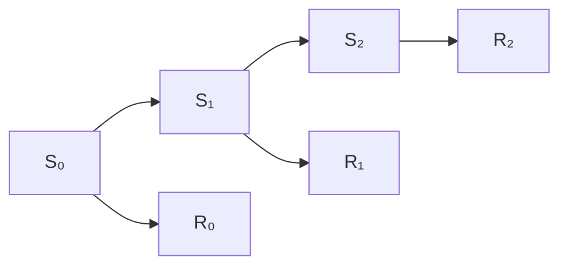

# 10/26/2026 — Scribe Notes

## Review

Finished exact inference in Bayesian networks (BNs). Now moving to sampling.

## Sampling in Bayesian Networks

- Estimate probabilities using random examples
- Useful when exact inference is too expensive
- More samples generally → better accuracy

Three methods:

- **Prior sampling:** Sample variables in parent before child order using the networkss probabilities.
- **Rejection sampling:** Throw out samples that dont match the evidence. Rare evidence means lots of wasted samples
- **Likelihood weighting:** Fix the evidence variables, sample the others, and weight each sample by how likely the evidence is given its sampled parents

### Sampling example

For the shape inside a rectangle on the board:

$$
P(\text{inside}) \approx \frac{G}{G+O}
$$

- G = number of samples inside the desired region
- O = number outside
- Samples are spread uniformly across the rectangle.

To estimate the shape’s area:

$$
\text{Area} \approx \frac{G}{G+O}\times w\times h
$$

## Hidden Markov Models (HMMs)

Used to estimate hidden states from observations as things change over time.

- S = hidden state
- R = observation / sensor reading
- Each state affects the next state and its own observation.

## Markov Assumptions

**Markov assumption:** Once we know the previous state, earlier states don’t add anything for predicting the current state

$$
P(S_t\mid S_{0:t-1})=P(S_t\mid S_{t-1})
$$

**Sensor assumption:** Once we know the current state, the current observation doesn’t depend on earlier states or observations

$$
P(R_t\mid S_{0:t},R_{0:t-1})=P(R_t\mid S_t)
$$

The colon means a range: R₁:ₜ = observations from time 1 through t.

## Filtering

Filtering estimates the **current hidden state using observations so far**:

$$
P(S_t\mid R_{1:t})
$$

Keep a probability distribution over the possible states and update it whenever new evidence arrives.

Two steps:

1. **Predict:** Use the previous state distribution to estimate the next state.
2. **Update:** Adjust that prediction using the new observation, then normalize.

## Filtering — Probability Update

The board switches notation here: X = hidden state, e = observed evidence.

Goal:

$$
P(X_{t+1}\mid e_{1:t+1})
$$

Separate old and new evidence:

$$
P(X_{t+1}\mid e_{1:t},e_{t+1})
$$

Apply Bayes’ rule:

$$
=\alpha P(e_{t+1}\mid X_{t+1},e_{1:t})P(X_{t+1}\mid e_{1:t})
$$

The sensor assumption lets us drop the old evidence from the first term. Then sum over possible previous states and use the Markov assumption:

$$
P(X_{t+1}\mid e_{1:t+1})
=\alpha P(e_{t+1}\mid X_{t+1})
\sum_{x_t}P(X_{t+1}\mid x_t)P(x_t\mid e_{1:t})
$$

- **P(xₜ | e₁:ₜ):** Our previous estimate — reuse it.
- **Sum:** Predict the next state using transition probabilities.
- **P(eₜ₊₁ | Xₜ₊₁):** How well the new evidence fits each possible state.
- **α:** Normalizes the result so probabilities add up to 1.

Basically: **predict → account for new evidence → normalize → repeat.**

## Board Example: Storm and River

- Hidden state: whether there’s a storm.
- Observation: the river reading.
- A storm’s probability depends on whether there was a storm the previous day.
- The river reading depends on the current storm state.

Day 0 prior: ⟨0.6, 0.4⟩ for storm / no storm.

Transition probabilities:

- P(storm today | storm yesterday) = 0.7
- P(storm today | no storm yesterday) = 0.4

Predict day 1:

$$
P(S_1=\text{true})=(0.7)(0.6)+(0.4)(0.4)=0.58
$$

So the prediction is ⟨0.58, 0.42⟩. Then observe that the river is low, use the sensor probabilities to update, and normalize.
